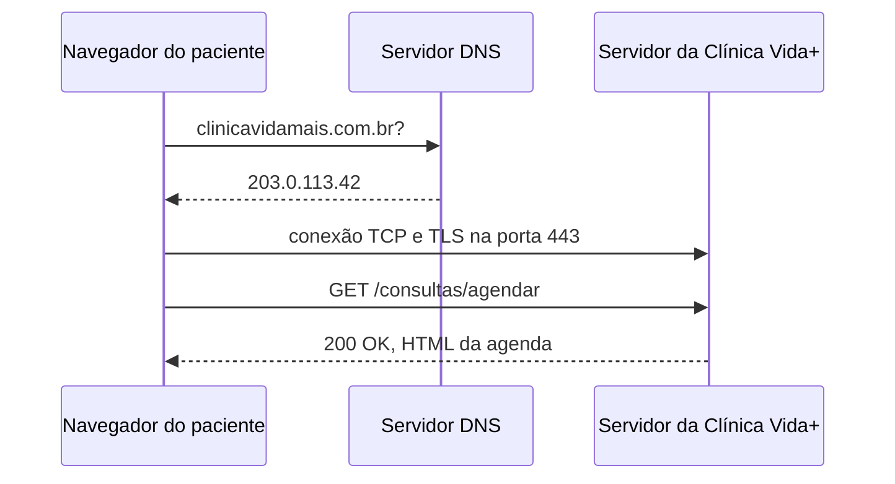

## O caminho de uma requisição



## Evidência do DNS

```text
C:\Users\leonida>nslookup github.com
Servidor:  one.one.one.one
Address:  1.1.1.1

Nome:    github.com
Address:  4.228.31.150

C:\Users\leonida>ping github.com
Disparando github.com com 32 bytes de dados:
Resposta de 4.228.31.150: bytes=32 tempo=12ms TTL=113
```
